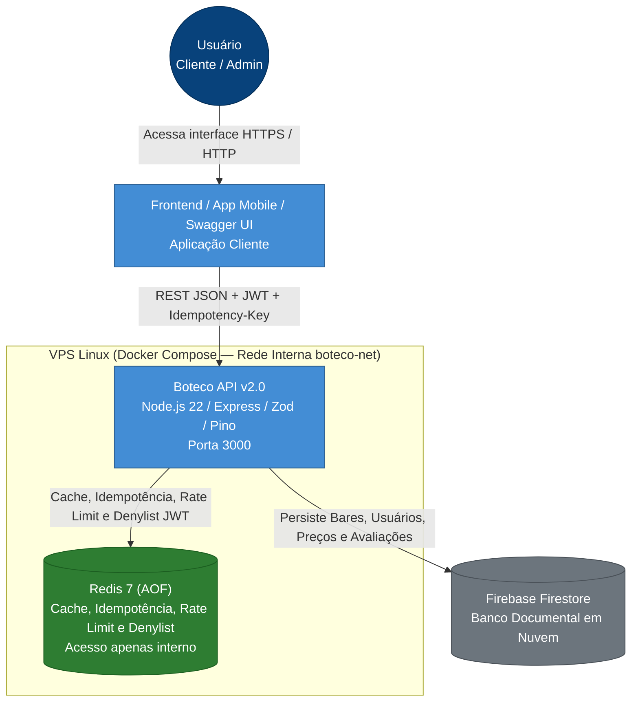
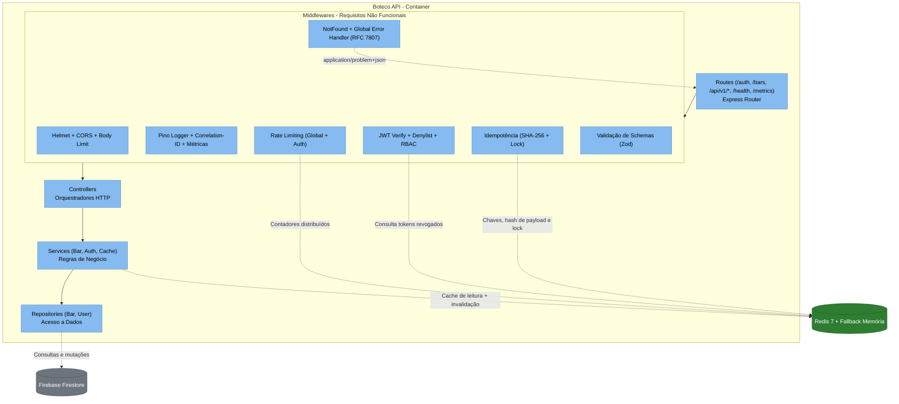
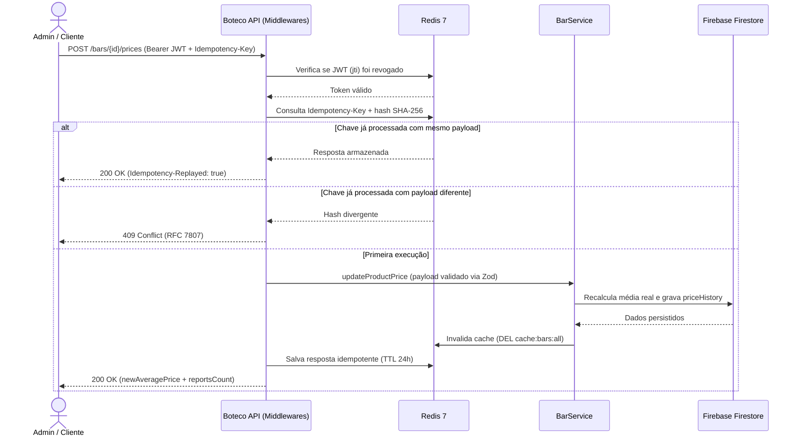

# Boteco API (v2.0)

API REST em **Node.js + Express** construída em **Arquitetura em Camadas**, utilizando **Firebase Firestore** como banco principal e **Redis** para cache, idempotência distribuída, rate limiting e revogação de tokens JWT.

---

## Principais Funcionalidades

- **Autenticação e Segurança (JWT + RBAC):**
  - Cadastro de usuários (`POST /auth/register`) com senhas criptografadas via `bcryptjs`.
  - Login (`POST /auth/login`) com emissão de **Access Token** e **Refresh Token** (`POST /auth/refresh`).
  - Logout com revogação imediata de token via denylist no Redis (`POST /auth/logout`).
  - Controle de acesso baseado em papéis (`cliente` e `admin`), headers de segurança (`helmet`), proteção contra força bruta e redação de dados sensíveis nos logs.
- **Gestão Completa de Bares (CRUD + Consultas Avançadas):**
  - Listagem paginada e busca por proximidade geográfica (`GET /bars?lat=...&lng=...&radius=...`), com filtros (`maxBeerPrice`) e ordenação (`sortBy`, `order`).
  - Pesquisa por nome, endereço ou tags insensível a acentos (`GET /bars/search?q=...`).
  - Ranking dos bares mais baratos por produto (`GET /bars/ranking?product=cerveja-600`).
  - Cadastro (`POST /bars`), consulta individual (`GET /bars/:id`), atualização (`PUT /bars/:id`) e remoção (`DELETE /bars/:id`).
- **Preços e Avaliações:**
  - Registro de preços (`POST /bars/:id/prices`) com cálculo de **média aritmética real acumulada** e histórico (`GET /bars/:id/prices/history`).
  - Avaliações de usuários autenticados (`POST /bars/:id/reviews` e `GET /bars/:id/reviews`) com atualização automática da nota média.
- **Resiliência e Observabilidade:**
  - **Cache Redis** com invalidação automática em mutações e cabeçalho `X-Cache: HIT | MISS`.
  - **Idempotência** (`Idempotency-Key`) com validação de hash SHA-256 do payload (`409 Conflict` em reuso divergente) e cabeçalho `Idempotency-Replayed: true`.
  - **Validação estruturada com Zod** e respostas de erro padronizadas no formato **RFC 7807** (`application/problem+json`).
  - **Logs estruturados (`pino`)** com `Correlation-Id` / `X-Request-Id`, além de endpoints `/health` e `/metrics`.
  - **Versionamento retrocompatível:** rotas disponíveis em `/` e `/api/v1`.

---

## Como Executar

### Pré-requisitos
- Node.js 20+ (recomendado Node 22 LTS) ou Docker + Docker Compose
- Arquivo `firebase-key.json` (Service Account do Firebase) na raiz do projeto

### 1. Executando com Docker Compose (API + Redis)

**Desenvolvimento local:**
```bash
docker compose up --build
```

**Produção em VPS (sem expor Redis para a internet, com `NODE_ENV=production` e rotação de logs):**
```bash
docker compose -f docker-compose.prod.yml up -d --build
```
Consulte o guia passo a passo completo em [DEPLOY-VPS.md](./DEPLOY-VPS.md).

A API ficará disponível em `http://localhost:3000` (ou `http://<IP_DA_VPS>:3000`), com o Redis conectado automaticamente em `redis://redis:6379`.

### 2. Executando Localmente

```bash
cp .env.example .env
npm install
npm run dev
```

> **Nota:** Caso o Redis não esteja em execução localmente, a API entra automaticamente em **modo de degradação graciosa** utilizando fallback em memória com TTL.

### 3. Executando os Testes Automatizados

```bash
npm test
npm run test:coverage
```

---

## Documentação Interativa (Swagger / OpenAPI 3.0)

Com o servidor rodando, acesse:
- **Swagger UI:** `http://localhost:3000/api-docs`
- **Especificação JSON:** `http://localhost:3000/api-docs.json`

### Credenciais de Demonstração

| Usuário | Senha | Papel (`role`) | Permissões |
|---|---|---|---|
| `admin` | `admin` | `admin` | Acesso total (CRUD de bares, preços, avaliações) |
| `cliente` | `cliente` | `cliente` | Consultas, perfil (`/auth/me`) e envio de avaliações |

---

## Mapa de Endpoints

| Método | Rota | Acesso | Descrição |
|---|---|---|---|
| `GET` | `/health` | Público | Readiness check (Firestore e Redis) |
| `GET` | `/health/live` | Público | Liveness probe para Docker HEALTHCHECK |
| `GET` | `/metrics` | Público | Métricas de requisições, latência, cache e memória |
| `POST` | `/auth/register` | Público | Cadastro de novo usuário (`cliente`) |
| `POST` | `/auth/login` | Público | Autenticação e emissão de Access + Refresh Token |
| `POST` | `/auth/refresh` | Público | Renovação do Access Token |
| `POST` | `/auth/logout` | Autenticado | Revoga o token JWT atual no Redis |
| `GET` | `/auth/me` | Autenticado | Retorna perfil do usuário logado |
| `GET` | `/bars` | Público | Lista paginada ou busca por proximidade (`lat`, `lng`, `radius`) |
| `GET` | `/bars/search` | Público | Busca textual insensível a acentos |
| `GET` | `/bars/ranking` | Público | Ranking de bares mais baratos por produto |
| `GET` | `/bars/:id` | Público | Detalhes de um bar |
| `POST` | `/bars` | Admin + Idempotência | Cadastra um novo bar |
| `PUT` | `/bars/:id` | Admin | Atualiza dados de um bar |
| `DELETE` | `/bars/:id` | Admin | Remove um bar |
| `POST` | `/bars/:id/prices` | Admin + Idempotência | Atualiza preço médio e registra histórico |
| `GET` | `/bars/:id/prices/history` | Público | Histórico de preços registrados |
| `POST` | `/bars/:id/reviews` | Autenticado + Idempotência | Publica avaliação (nota 1–5 e comentário) |
| `GET` | `/bars/:id/reviews` | Público | Lista avaliações do bar |

---

## Arquitetura e Diagramas

### 1. Diagrama de Containers (C4 — Nível 2 / Deploy Docker na VPS)



### 2. Diagrama de Componentes — Boteco API (C4 — Nível 3)



### 3. Fluxo de Operação Protegida com Idempotência e Invalidação de Cache



Para justificativas técnicas detalhadas e comparativo completo entre a 1ª e a 2ª entrega, consulte [doc-arquitetura.md](./doc-arquitetura.md).
