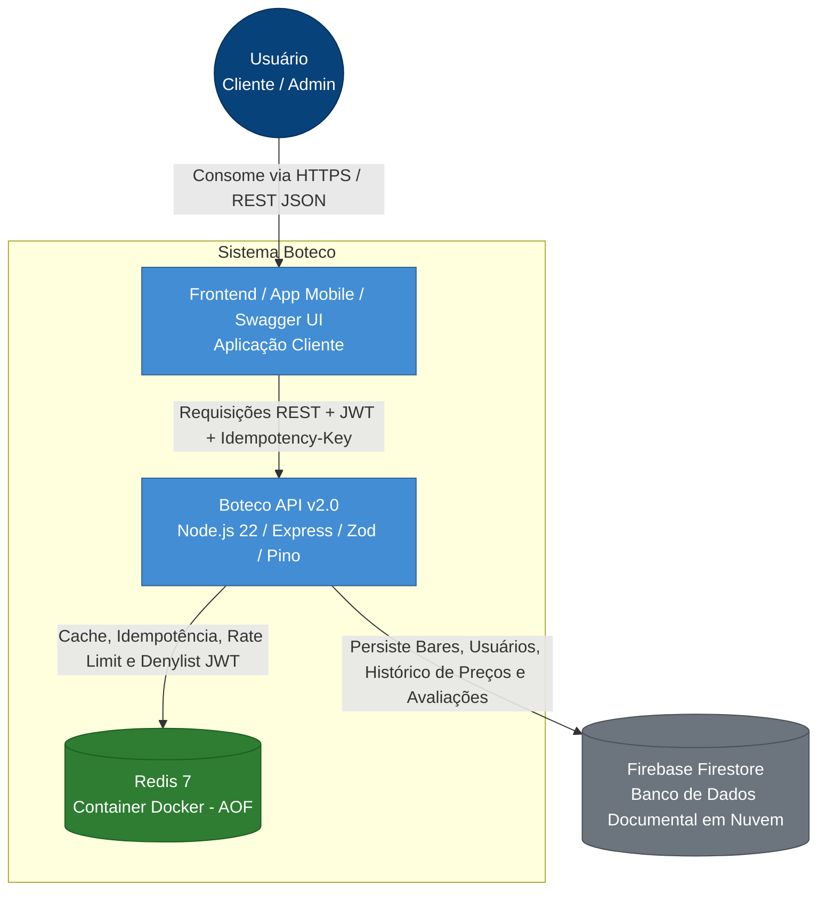
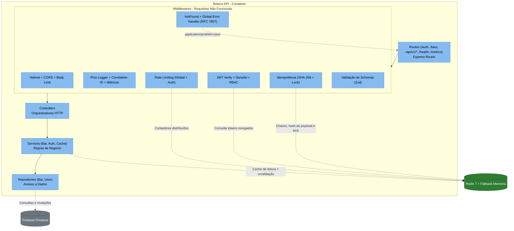

# Documentação Arquitetural - Boteco API (v2.0)

Em atendimento aos requisitos do projeto (Atividade Prática 2026 — 2ª Entrega), abaixo estão os diagramas no modelo C4, a evolução arquitetural implementada e as justificativas técnicas para cada decisão.

## 1. Diagrama de Containers (C4 — Nível 2)

Este diagrama mostra os componentes de alto nível do sistema, como os usuários interagem com eles e como a API se comunica com os dois bancos de dados (poliglotismo de persistência).

## 2. Diagrama de Componentes — Boteco API (C4 — Nível 3)

Este diagrama detalha as camadas internas da **Boteco API**, aplicando Arquitetura em Camadas, Separação de Responsabilidades e os Requisitos Não-Funcionais da atividade.

---

## 3. Evolução da 1ª para a 2ª Entrega

| Dimensão | 1ª Entrega (v1.0) | 2ª Entrega (v2.0) |
|---|---|---|
| **Redis** | Container declarado no Docker Compose, porém não conectado na aplicação | Integração real com `ioredis` (cache com `X-Cache: HIT/MISS`, idempotência distribuída com TTL, rate limiting e revogação de JWT) + degradação graciosa em memória |
| **Autenticação e Segurança** | Login mockado (`admin/admin`) no controller e `JWT_SECRET` hardcoded | Camada completa (`AuthService` + `UserRepository`), cadastro com `bcryptjs`, Access + Refresh Tokens, logout com revogação (`jti` no Redis), `helmet`, `.env`, redação de segredos nos logs e rate limit dedicado em `/auth/*` |
| **Domínio e Endpoints** | Apenas 3 rotas de bares (`GET /bars`, `GET /bars/search`, `POST /bars/:id/prices`) | CRUD completo de bares (`POST/GET/PUT/DELETE`), filtros/ordenação/paginação, busca insensível a acentos, ranking de menor preço (`/bars/ranking`), histórico de preços (`/bars/:id/prices/history`) com média aritmética real acumulada e sistema de avaliações (`/bars/:id/reviews`) |
| **Validação de Entrada** | Validações manuais pontuais nos controllers | Middleware genérico com **Zod** validando `body`, `query` e `params`, retornando lista detalhada de erros no padrão RFC 7807 |
| **Idempotência** | `Map` em memória sem expiração nem detecção de conflito | Armazenamento no Redis com TTL (24h), hash SHA-256 do payload (`409 Conflict` em reuso divergente), lock contra concorrência e header `Idempotency-Replayed: true` |
| **Observabilidade e Operação** | Apenas `pino-http` e `Correlation-Id` | Endpoints `/health` (verifica Firestore e Redis) e `/metrics` (latência, requisições, cache hit rate, memória), RFC 7807 (`application/problem+json`) inclusive para 404 e JSON inválido, além de shutdown gracioso |
| **Testes Automatizados** | Nenhum teste | Suíte completa com **Jest** e **Supertest** (testes unitários de serviços e testes de integração HTTP) |
| **Docker & DevOps** | Node 18 como root, sem healthchecks | Node 22 Alpine, usuário não-root (`USER node`), `HEALTHCHECK` na API e no Redis, volume persistente AOF no Redis |

---

## 4. Justificativas Arquiteturais

### A. Poliglotismo de Persistência (Firestore + Redis)

1. **Firebase Firestore (Nuvem — Persistência Principal):**
   - Banco NoSQL orientado a documentos, ideal para entidades independentes (`bars`, `users`) e subcoleções temporais (`bars/{id}/priceHistory` e `bars/{id}/reviews`).
2. **Redis 7 (Container Docker — Memória Auxiliar e Resiliência):**
   - **Cache de Leitura (`cache:bars:all`):** reduz leituras repetitivas no Firestore em consultas de proximidade, busca e ranking, com invalidação automática em qualquer mutação e visibilidade via header `X-Cache: HIT | MISS`.
   - **Idempotência Distribuída:** garante segurança em retentativas de rede para criação de bares, registro de preços e envio de avaliações, detectando reutilização indevida da chave com payloads distintos (`409 Conflict`).
   - **Rate Limiting Distribuído:** compartilha janelas de controle de vazão entre múltiplas réplicas da API, com limite mais rígido nas rotas de autenticação contra força bruta.
   - **Revogação de Tokens (Denylist):** permite invalidar JWTs imediatamente no `/auth/logout`, armazenando o `jti` apenas até o tempo restante de expiração do token.
   - **Degradação Graciosa:** caso o Redis esteja fora do ar ou a API seja executada localmente sem Docker, o cliente alterna automaticamente para um store em memória com TTL, preservando a disponibilidade da aplicação.

### B. Arquitetura em Camadas e Isolamento de Responsabilidades

1. **Camada de Transporte e Middlewares (`routes` + `middlewares` + `validators`):**
   - Concentra todos os requisitos não-funcionais: segurança (`helmet`, CORS, limite de payload), observabilidade (`pino-http`, `Correlation-Id`, métricas), rate limiting, autenticação/RBAC, idempotência, validação de entrada (Zod) e padronização de erros (RFC 7807).
2. **Controllers (`controllers`):**
   - Tradutores enxutos entre HTTP e a camada de domínio, sem regras de negócio embutidas.
3. **Serviços / Domínio (`services`):**
   - Contém as regras de negócio puras: cálculo de distância geoespacial (`geolib`), média aritmética real acumulada de preços, cálculo de nota média das avaliações, ordenação/paginação, gestão de cache e fluxos de autenticação.
4. **Repositórios (`repositories`):**
   - Isola completamente o SDK do Firebase Firestore, facilitando testes unitários/integração via mocks e eventual migração de banco de dados.
